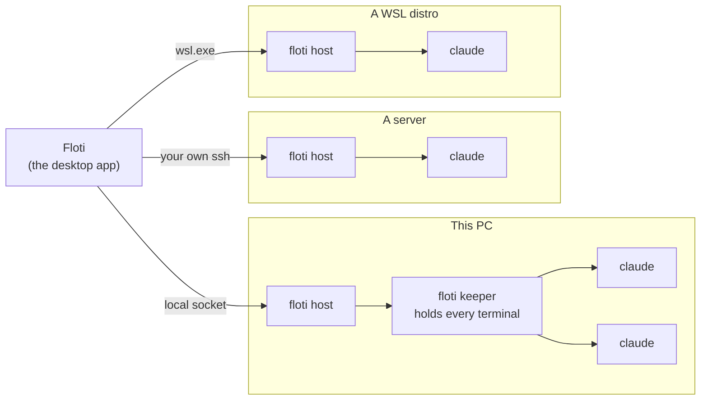

<h1 align="center">
  <picture>
    <source media="(prefers-color-scheme: dark)" srcset="assets/brand/lockup-colour-dark.svg">
    
  </picture>
</h1>

<p align="center">
  <strong>Your coding agents, on every computer you have, in one window.</strong>
</p>

<p align="center">
  <a href="https://floti.dev">floti.dev</a> ·
  <a href="#install">Install</a> ·
  <a href="https://github.com/floti-dev/floti/wiki">Wiki</a> ·
  <a href="https://github.com/floti-dev/floti/releases">Releases</a> ·
  <a href="CHANGELOG.md">Changelog</a>
</p>

Floti is a desktop app for Claude Code. A small host program, `floti`, runs on
each of your computers and holds every session, so the app can crash or
restart without taking your agents with it. The app shows the real `claude`
terminal in tabs,
with sessions on your servers and WSL distros beside the ones on this PC, and
adds what the CLI doesn't have around it: your projects, saved launch
profiles, history across every folder, a Files view and a browser pane.

Floti is Old Norse for a fleet, said FLOH-tee.

> [!NOTE]
> **Floti is a personal project, shared as-is.** I build it for my own use and
> publish it in case it's useful to you. I don't take pull requests, issues,
> feature requests or support questions, and there's no roadmap: it changes
> when I need it to, sometimes in ways that break things. You're welcome to
> fork it under the [Apache 2.0 license](LICENSE); please give your fork a
> different name. Security reports are the one exception, see
> [SECURITY.md](.github/SECURITY.md).

## What it does

- **Sessions outlive the window.** Every session's terminal is held by a
  keeper process the host runs, apart from the app. If Floti crashes, your
  agents keep working, and when you quit you choose whether they keep running.
  Open it again and they're where you left them.
- **Every computer in one window.** This PC, any machine you reach with your
  own `ssh`, and each WSL distro, side by side. There's no account and no
  service in between: your login is the access.
- **The agent's own terminal.** Claude Code runs in its real TUI, in xterm.js.
  Floti passes every key and byte through untouched; it never draws over a
  live session, parses its output or answers a permission prompt.
- **Agents that run agents.** A session can start child sessions, hear what
  they report and stop them, each in a tab you can watch.
- **Skills from every repo at once.** A profile launches a session from the
  folder you pick, with the skills, agents and `CLAUDE.md` of other projects
  composed in. [How that works](#composing-projects) is below.
- **History** (Ctrl+H) of every Claude Code session you've run, in every
  folder, which `/resume` can't show because it only reads the folder it
  starts in. Search names, prompts and archived conversations, then resume one
  or read it back. Claude Code deletes old transcripts, so Floti marks which
  sessions can still be resumed instead of offering a resume that fails.
- **Files** for each project: the tree with git status, Ctrl+P by name,
  Ctrl+Shift+F by content, and the Markdown and HTML that Claude writes shown
  rendered, with an editor beside a live preview for notes.
- **A browser pane** that your agents can drive too: open a page, read it,
  screenshot it, click and type, within limits you set.
- **Workspaces, templates, themes and plugins.** A plugin can add a rail icon
  and panel, tabs, a status bar item, commands and tools for your sessions,
  and runs in a process of its own so a crash takes nothing else down. The
  [plugin SDK](packages/plugin-sdk/README.md) is `@floti-dev/plugin-sdk` on
  npm.

### How it fits together



The app is a client of each host. A session's processes belong to that host's
keeper, so a crash or an update of the app ends nothing, and quitting ends a
session only when you say so.

## Install

Floti has two parts: `floti`, the host and command-line tool, which goes on
every computer you want agents on, and the desktop app, which goes on the
computer you sit at.

You also need [Claude Code](https://claude.com/claude-code) installed and
signed in. Floti runs the real `claude` CLI. It doesn't bundle
one and never handles your credentials.

### floti

macOS, Linux and WSL:

```sh
curl -fsSL https://floti.dev/install.sh | sh
```

Windows, in PowerShell:

```powershell
irm https://floti.dev/install.ps1 | iex
```

Either script puts `floti` in your own folder (`~/.local/bin`, or
`%LOCALAPPDATA%\Programs\Floti\bin`) with no admin rights, after checking it
against the SHA-256 the script was released with, and then runs
`floti setup`. Setup checks Claude Code, puts floti's folder on your `PATH`
and, on macOS and Linux, starts the host at each sign-in. On Windows the host
starts when the app or a connection needs it. Where there's a display, setup
also offers to install the desktop app.

On macOS and Linux, Homebrew installs floti too, without the desktop app. It
trusts the tap first, because Homebrew loads no formula from a tap it doesn't
trust:

```sh
brew trust floti-dev/tap && brew install floti-dev/tap/floti
```

### The desktop app

`floti add desktop` installs the app of floti's own version for your user,
with no admin rights, and checks the download's signature and SHA-256 before
anything runs. You can also download it from the
[latest release](https://github.com/floti-dev/floti/releases/latest):

| Computer | File |
|---|---|
| Windows 10 or 11, x64 | `Floti-<version>-setup.exe` installs for your user only. `Floti-<version>-portable.exe` is one file that keeps its data in `helm-data\` beside itself. |
| macOS, Apple Silicon | `Floti-<version>-arm64.dmg`, or the same app as `Floti-<version>-arm64-mac.zip` |
| Linux x64 with glibc 2.34 or later (Ubuntu 22.04, Debian 12, Fedora 35, RHEL 9 and newer) | `Floti-<version>-linux-x64.AppImage` |

The builds aren't signed with a paid certificate, so expect a warning the
first time:

- **Windows** says "Windows protected your PC". Choose **More info**, then
  **Run anyway**.
- **macOS** blocks the app the first time you open it, and Control-click >
  Open doesn't get past that. Open **System Settings > Privacy & Security**,
  choose **Open Anyway**, and open the app again.
- **Linux** on Ubuntu 23.10 and later starts the AppImage without Chromium's
  sandbox, so Floti keeps the browser pane off. The Browser tab shows the one
  `sudo` command that fixes it.

If you'd rather check than trust, every file in a release is built from the
tagged commit by [`release.yml`](.github/workflows/release.yml) on a clean
runner, and carries a minisign signature and a GitHub build attestation.

### First run

1. **Claude Code.** Floti looks on your `PATH` and in the usual install folder,
   and you can point it at another. Outside the range of versions Floti was
   tested with you get a warning strip, and nothing is blocked. `floti doctor`
   checks the same from a terminal.
2. **Signed in.** Floti checks that a login exists, never by reading it. If
   you aren't signed in, run `claude` once in a terminal. There's no login
   screen anywhere in Floti.
3. **Your work.** Add a folder, or create a workspace. Nothing is scanned
   until you say what to scan. A folder of ordinary repositories is enough;
   there's no required layout.

## Composing projects

Claude Code reads its `.claude/` configuration (skills, agents, commands,
`CLAUDE.md`) from the folder a session starts in, which forces a choice at
launch:

| Launch from | You get | You lose |
|---|---|---|
| The workspace root | every repository, and the workspace's own tooling | each repository's own skills and agents |
| One repository | that repository's skills and agents | the other repositories |

Floti takes that choice away. For each project you compose in, it builds a
throwaway plugin in its own data folder: a manifest plus links (junctions on
Windows, symlinks elsewhere) to the project's real `.claude/skills`,
`commands`, `agents` and `workflows`. Then it starts `claude` from the root
you picked, with one `--plugin-dir` per project, `--add-dir` for the folders
the session may touch, and the projects' `CLAUDE.md` files joined into one
`--append-system-prompt-file`.

Claude Code prefixes everything a plugin brings with the plugin's name, and
Floti picks the name, so nothing collides: a skill called `think` in a
project composed as `api` is `/api:think`, and a second project's `think`
keeps its own prefix.

A saved composition is a **profile**: the root, the projects, what the session
may reach, and its model, effort, permission mode, MCP servers and opening
prompt. It launches in one click and exports as YAML, so it can travel with
the workspace. A **workspace** is any folder with a `workspace.yaml` in it.
The [wiki](https://github.com/floti-dev/floti/wiki) covers workspaces,
templates and why Floti is built around them.

## Hosts on other computers

A host on another computer is reached through your own `ssh` login, a command
you choose, or `wsl.exe`, which runs `floti connect` there as you. That login
is the access: adding a host is connecting to it, with no pairing code,
approval or role. Floti pins the host's key at the first connection and
refuses a host that proves a different one. It adds no ssh options, skips no
host-key check and reads nothing under `~/.ssh`.

**Settings → Hosts** installs floti on another computer for you, once you
agree to an offer that names its OS and CPU. **Settings → Devices** shows who
is attached to each host, with Disconnect beside each; to keep a lost device
out, take its SSH key away as you would for any machine.

## Updates

floti updates itself. While **Settings → Updates → Update floti by itself** is
on (it is by default), the host reads floti.dev's signed `update.json` at
most once a day. When there's a newer floti, it downloads it, checks it
against the key built into floti and its SHA-256, puts it in place and
restarts on it. Every session keeps running throughout. `floti update` does
the same when you run it, and updates the desktop app too.

The app itself checks nothing. It shows what the host found beside the
version in the status bar, and **Settings → Updates** has **Check now**,
**Update** and a link to the release notes. A development build checks
nothing and updates nothing.

## Privacy and the network

**The host's update check, at most once a day to floti.dev and to the
GitHub release it names, is the only request Floti makes on its own
initiative; the app itself contacts nothing.
Everything else on the network happens because you asked for it: Check
now and Update ask the host to check or to update, the browser pane
fetches the page you navigate to, a plugin you added reaches the hosts
its manifest names, and a host you added on another computer is reached
through your own ssh, or the command you gave.** There is no telemetry, no
crash reporting, no fonts and no CDN, and with the tick off nothing asks
anything unless you press something.

**Floti listens only on this machine.** Its windows reach the local host over
the host's local socket, which only your OS account can open. The local host
listens on `127.0.0.1` for its sessions' agent tools, behind a token minted
for each session and revoked when it ends, and holds no port while no tool
family is on. Floti's own process listens on `127.0.0.1` only for a port you
forwarded from a session on another computer, and closes it when that session
ends.

The agent tools are three sets, each with its own switch in Settings: the
browser pane's, a read-only set that tells a session what the other Claude
Code sessions on this machine are doing (never any part of their
conversations), and one that starts and talks to the session's own child
sessions. A switched-off set isn't registered with any session. Plugins reach
only the hosts their manifests name, and a secret you give a plugin is sealed
by your OS's own store and never handed back to its pages.
[docs/PACKAGING.md](docs/PACKAGING.md#network-posture) and
[docs/SECURITY.md](docs/SECURITY.md) have the details.

## Uninstalling

`floti uninstall` stops the host, which ends any running sessions (their
history stays), then removes what installing put there: the start-at-sign-in
entry, the desktop app, floti's `PATH` entry, and floti with its Node. It
prints one line for each, or `not found`, so running it again changes nothing.
Run it from a terminal Floti didn't start.

Your data and config folders stay. `floti uninstall --purge` removes them as
well, with Floti's entry in your keychain or keyring, and never touches
`~/.claude`, `~/.ssh` or any repository.

## Documentation

- [The wiki](https://github.com/floti-dev/floti/wiki): workspaces, how Floti
  finds your projects, overlays, templates, themes, and writing plugins.
- [The plugin SDK](packages/plugin-sdk/README.md): the manifest, the bridge,
  the primitives and the `helm-plugin` CLI.
- How Floti is built, in `docs/`:
  [ARCHITECTURE](docs/ARCHITECTURE.md) (processes, sessions, tabs, the browser
  pane, overlays, the Files view),
  [AGENT-TOOLS](docs/AGENT-TOOLS.md),
  [PLUGINS](docs/PLUGINS.md),
  [SECURITY](docs/SECURITY.md) (credentials, keys, the secret store),
  [PACKAGING](docs/PACKAGING.md) (what a release carries, where data goes,
  updates),
  [TESTING](docs/TESTING.md),
  [DESIGN](docs/DESIGN.md) and
  [SPEC](docs/SPEC.md) (the measured evidence behind past decisions).
- [CLAUDE.md](CLAUDE.md): the rules the code must not break, one line each.

## Building from source

You need Node 22 or later, pnpm 10, and the Rust toolchain that
`rust-toolchain.toml` names.

```sh
pnpm install
pnpm dev            # the app, with hot reload, in a data folder of its own
pnpm dev --fresh    # ...starting from no database, which is a first run
pnpm check          # typecheck, lint, and the unit and integration tests
pnpm build          # a production build
pnpm dist:win       # the Windows portable exe and installer
```

`pnpm dist:mac` and `pnpm dist:linux` build the other two on their own OS.
`pnpm dev` keeps its data in a folder of its own (`%LOCALAPPDATA%\Floti Dev\dev`
on Windows), so it runs beside an installed Floti. It does share your real
`~/.claude`, because moving that moves your Claude login too.

A release is a version bump in `packages/desktop/package.json` merged to
`main`; CI builds, checks, signs and publishes everything
([docs/PACKAGING.md](docs/PACKAGING.md#releasing)). Nothing is built on a
laptop.

## Contributing

Pull requests and issues are turned off, as the note at the top says.
[CONTRIBUTING.md](.github/CONTRIBUTING.md) has the same in one place, and
[SECURITY.md](.github/SECURITY.md) says how to report a vulnerability.

## License

Floti is licensed under the [Apache License 2.0](LICENSE); see also
[NOTICE](NOTICE). The license covers the code, not the Floti name or logo, so a
fork should use its own.

The third-party code Floti ships keeps its own licenses. The desktop app
carries their texts as `THIRD-PARTY-NOTICES.txt` in its resources folder,
beside Electron's and Chromium's, and every release attaches
`floti-<version>-THIRD-PARTY-NOTICES.txt` for the floti binaries.
